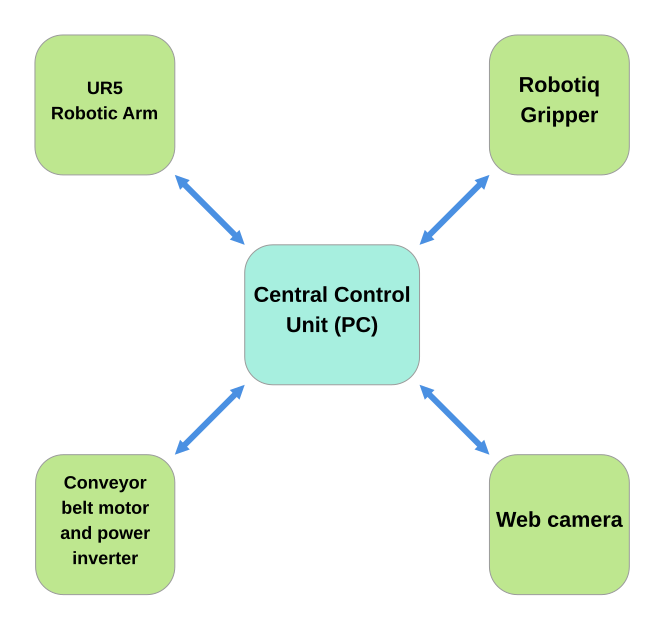
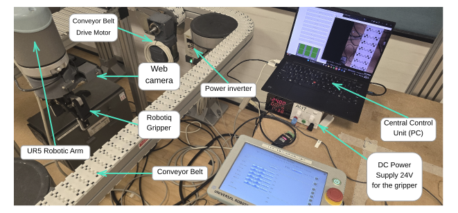
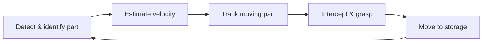

# Vision-Guided Robotic System for Real-Time Object Tracking and Handling

This project was developed as part of my Master's thesis at the Technical University of Denmark. The objective was to develop a robotic system for detecting, tracking, and picking different objects from a moving conveyor belt using visual input from a camera mounted on the robot's end effector.

## Overview

The system consists of:
- **UR5 Cobot** - for pick-and-place operations,
- **Webcam (1920 x 1080)** - used for visual input,
- **Conveyor belt** - supplied various parts for the robotic arm to handle,
- **PC** - runs image processing, controls the robot and handles communication,
- **Robotiq Gripper** - grasps objects from the conveyor belt.


The project was developed primarily in Python, with OpenCV used for computer vision.


## System Architecture

<p align="center">
  
</p>

<p align="center">
  <i>System architecture and communication interfaces.</i>
</p>

## Project Setup

<p align="center">
  
</p>

<p align="center">
  <i>Physical setup.</i>
</p>

## Process flow



## Repository Structure

```text
Master-Thesis/
├── Calibration/                  # Camera and hand-eye calibration tools
├── Plots/                        # Experimental results and evaluation plots
├── Tests/                        # Development and system tests
├── Thesis/                       # Master's thesis report and LaTeX source
├── calibration_images/           # Images used for intrinsic camera calibration
├── calibration_images_hand_eye/  # Images used for hand-eye calibration
│
├── main.py                       # Main system loop and component integration
├── camera.py                     # Object detection, localization and camera transformations
├── robot_control.py              # Object tracking, interception and pick-and-place control
├── conveyor_belt.py              # Conveyor inverter control via Modbus RTU
├── gripper.py                    # Robotiq gripper control via Modbus RTU
├── gui.py                        # System control and calibration GUI
├── ur.py                         # UR robot motion commands via TCP/IP
├── urData.py                     # Real-time UR robot pose acquisition
├── misc.py                       # Modbus CRC calculation
│
├── calib_param.txt               # Intrinsic camera calibration parameters
├── calib_param_hand_eye.txt      # Hand-eye calibration parameters
├── slider_params_*.json          # Object-specific vision parameters
└── README.md                     # Project documentation
```

## Thesis

For a detailed description of the system design, implementation, calibration and testing, see the full Master's thesis:

📄 [View Master's Thesis](./Thesis/Master_Thesis.pdf)